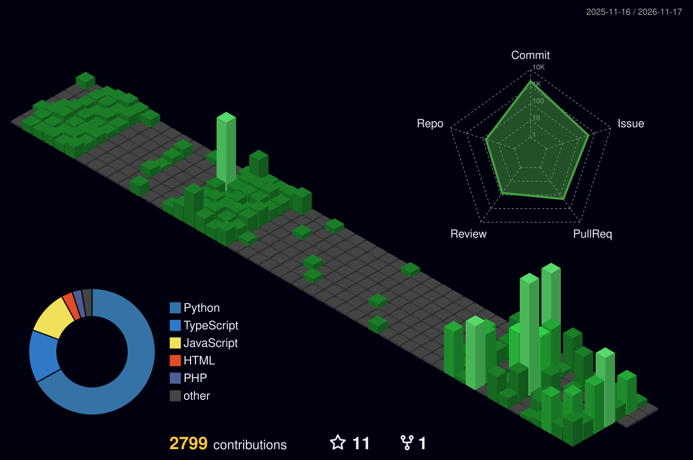

# Neev Modh

<samp>AI / ML Engineer · Full-Stack & Data Systems · Ahmedabad, India</samp>

<samp>I take ML from experiment to working product: models evaluated on held-out data, wrapped in software that is tested and shipped.</samp>

<samp>
<a href="https://www.linkedin.com/in/neev-modh-43478a285/">linkedin</a> ·
<a href="https://github.com/neevmodh">github</a> ·
<a href="mailto:neevmodh205@gmail.com">mail</a>
</samp>

 

<picture>
  <source media="(prefers-color-scheme: dark)" srcset="https://raw.githubusercontent.com/neevmodh/neevmodh/main/profile-3d-contrib/profile-night-green.svg" />
  <source media="(prefers-color-scheme: light)" srcset="https://raw.githubusercontent.com/neevmodh/neevmodh/main/profile-3d-contrib/profile-green.svg" />
  
</picture>

### now

**Nidhi — TiE Global Summit BUILD 2036** — Frontier 2: Climate & Clean Energy, 2026
 <samp>working prototype submitted: live smart meter + AI energy agent for Gujarat's Mission LiFE</samp>

**Novix — AI-powered healthcare venture** — Founder & AI Engineer, 2026
 <samp>LLM + RAG system turning fragmented medical records into clinical decision support · Python/FastAPI</samp>

**IIT Delhi — Metamorphosis 2026** — Technical Mentor, AI/ML, May 2026 – present
 <samp>1 of 9 mentors chosen nationally · deep learning, NLP and solution-design sessions · code and architecture reviews</samp>

**IIIT Delhi — Young Creators Bootcamp (YCB 7)** — Program Head, Jun 2026
 <samp>led a week-long AI/ML + entrepreneurship bootcamp · coordinated 20+ mentors for 100+ students</samp>

### 🌟 open source

<samp>

[![LMCache](https://img.shields.io/github/pulls/detail/state/LMCache/LMCache/5306?style=flat-square&label=LMCache&logo=&labelColor=161b22)](https://github.com/LMCache/LMCache/pull/5306)

</samp>

### 🏆 hackathons & achievements

<samp>
ETHGlobal Mumbai — global finalist · <a href="https://github.com/neevmodh/nidhi">nidhi</a>, cross-chain DAO grant payouts 
Global iSAFE Hackathon 2026 — top 20 teams, 120+ countries · <a href="https://github.com/neevmodh/PHANTOM-PROTOCOL">Phantom Protocol</a> 
India–Israel International Hackathon — 3rd of 600+ squads · <a href="https://github.com/neevmodh/Restorative-Care-">Restorative Care</a> 
IntelliSmart INSTINCT 4.0 — national grand finale, top 5 · <a href="https://github.com/neevmodh/EcoPower2.0">EcoPower 2.0</a> 
IIT Gandhinagar HackCult — 3rd rank, solo vs squads 
IIT Delhi SquareHacks — final 6, countrywide 
NIT Hamirpur Hackathon — top 10 nationwide 
DDCET 2025 — AIR 174 of 19,000 (99th percentile)
</samp>

### featured work

**🤖 AI / ML**

| project | what it does | result |
|---|---|---|
| [**Roomnesia**](https://github.com/neevmodh/Roomnesia) | 3D change detection for robots from two phone videos · VGGT, Grounding DINO, SigLIP | 90% recall on 21 held-out real pairs · model load 555 s → 6 s |
| [**GraphSleuth**](https://github.com/neevmodh/graphsleuth) | fraud investigation agent: the LLM proposes, a deterministic policy engine approves | 0.934 AUC on later months · 84 tests |
| [**MATRIVA**](https://github.com/neevmodh/MATRIVA) | evidence-grounded pregnancy companion · RAG that cites a source or refuses | 71% clean held-out vs 95% tuned, reported honestly |
| [**SignTrace**](https://github.com/neevmodh/SignTrace) | traffic-sign recognition · MobileNetV3 fine-tuned in PyTorch, leakage-safe splits | 84.04% accuracy on the official GTSRB test set |
| [**Solar-intel**](https://github.com/neevmodh/Solar-intel) | solar fleet intelligence · XGBoost maintenance, RAG chat, agentic workflow | 0.981 AUC-ROC · [live](https://solar-intel-six.vercel.app/chat) |

**⚡ energy & climate**

| project | what it does | links |
|---|---|---|
| [**Nidhi**](https://github.com/neevmodh/Nidhi-LiFE) | Mission LiFE app for Gujarat: live smart meter, AI energy agent, meter-proved actions, society duels, DISCOM + GEDA consoles · FastAPI, Next.js, Expo · 451 tests | [live](https://nidhi-gujarat.vercel.app) · [demo](https://youtu.be/PRn3FF_PhPI) |
| [**EcoPower 3.0**](https://github.com/neevmodh/EcoPower3.0) | Energy-as-a-Service above AMI · 64 migrations, RLS checked by 299 pgTAP assertions, MQTT ingest, tariff engine | [live](https://ecopower3.vercel.app) |
| [**EcoPower 2.0**](https://github.com/neevmodh/EcoPower2.0) | smart solar management · three role-based dashboards, AI recommendations · INSTINCT 4.0 finalist | [live](https://eco-power2-0.vercel.app) |

**🗄️ data & systems**

| project | what it does |
|---|---|
| [**ARGUS**](https://github.com/neevmodh/ARGUS) | big-data accident risk platform over 7.7M records · HDFS, MapReduce, Hive, Spark ML, Kafka streaming, MongoDB, Airflow |
| [**Prahari**](https://github.com/neevmodh/Prahari) | cross-camera vehicle tracking for Gujarat Police CCTV · reads a plate end to end in 0.68 s · 348 tests in CI |
| [**ShipSync**](https://github.com/neevmodh/shipsync) | one shared shipment record for exporters, forwarders, brokers and transporters · LogiTHON 2026 · [live](https://shipsync-pink.vercel.app) |

### stack

<samp>
<b>AI / ML</b> — Python · PyTorch · scikit-learn · XGBoost · OpenCV · 3D reconstruction · LLMs · RAG · agentic AI 
<b>backend & data</b> — FastAPI · PostgreSQL (RLS, partitioning) · Supabase · MongoDB · Kafka · Spark · Hadoop · Airflow 
<b>frontend & mobile</b> — TypeScript · React · Next.js · React Native / Expo · Tailwind · three.js 
<b>ship</b> — Docker · GitHub Actions · Vercel · Render · AWS · Linux
</samp>

### education

<samp>
Nirma University — B.Tech, Artificial Intelligence & Machine Learning, 2025 – 2028 
Government Polytechnic (GTU) — Diploma, Computer Engineering, 2022 – 2025
</samp>

### stats

 

